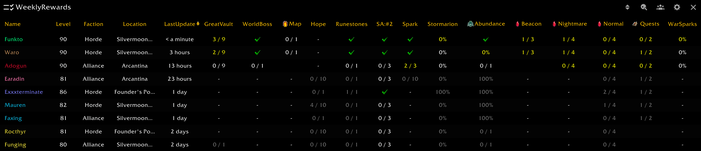
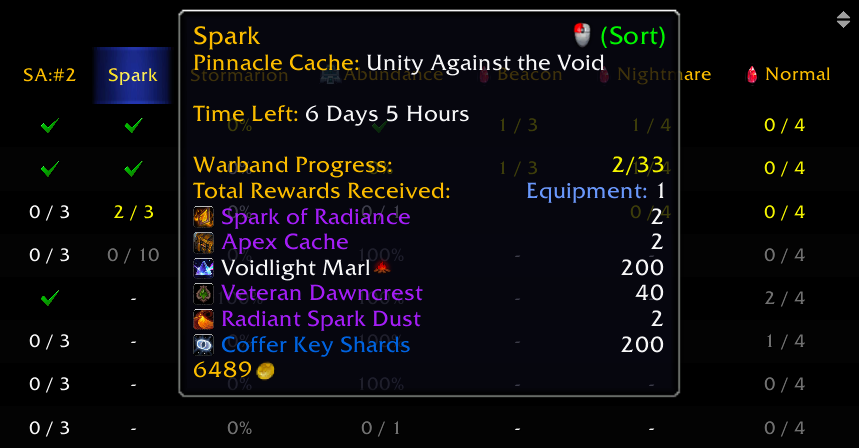
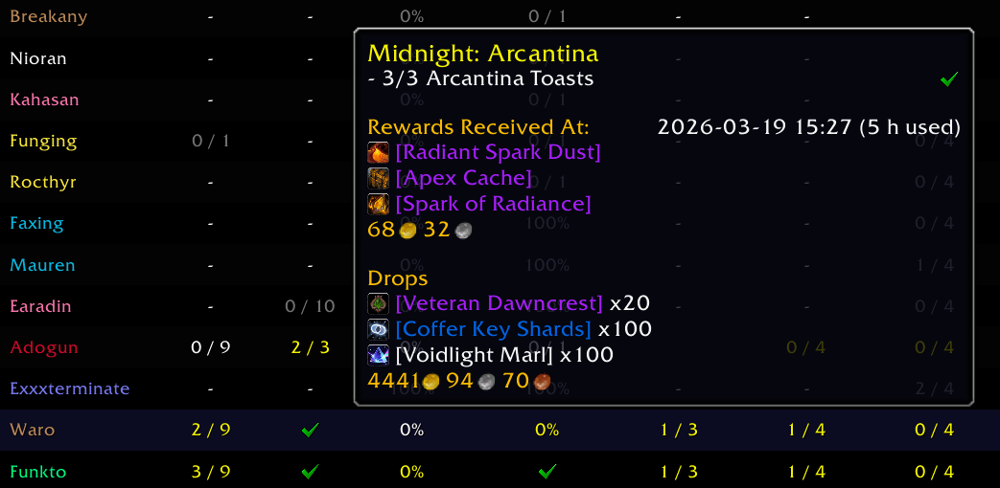
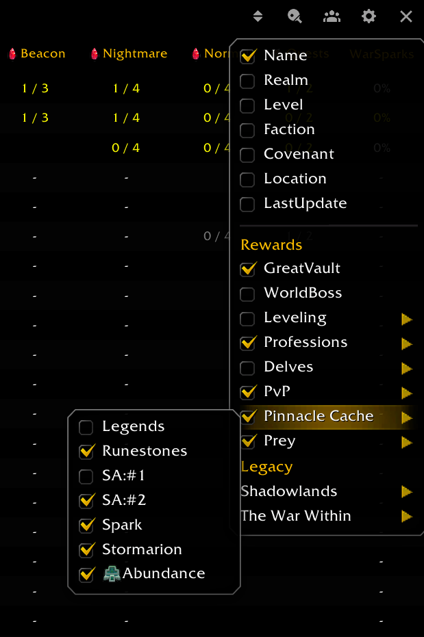

# WeeklyRewards

WeeklyRewards is a grid of your characters and their weekly reward progress. Log in on each character to collect its status, then see what is finished and what is still open.

## Features

- **Grid.** Laid out like a spreadsheet: one row per character and one column per reward. Click a column header to sort. Drag a reward name to move that column. Each cell shows progress as a count, a percent, or a checkmark.
- **Filters.** Show or hide character columns and reward groups.
- **Warband progress.** Hover a reward header for totals across your characters, time left, and rewards already received.
- **Character progress.** Hover a cell for that character's objectives, when rewards were received, and drops.
- **Notes.** Click a character name to add a note. It appears beside the name and in the tooltip.
- **Open the window.** A keybinding is the fastest way: in Key Bindings, under WeeklyRewards, bind **Show/Hide the window of WeeklyRewards**. Left-click the minimap button to open it too. Drag that icon to move it.

## Screenshots

### Main window

### Warband progress

### Character progress

### Column and reward filters

## Feedback

Bugs and ideas: [open an issue](https://github.com/cybertk/WeeklyRewards/issues).

Pull requests are welcome on the [same repository](https://github.com/cybertk/WeeklyRewards).
